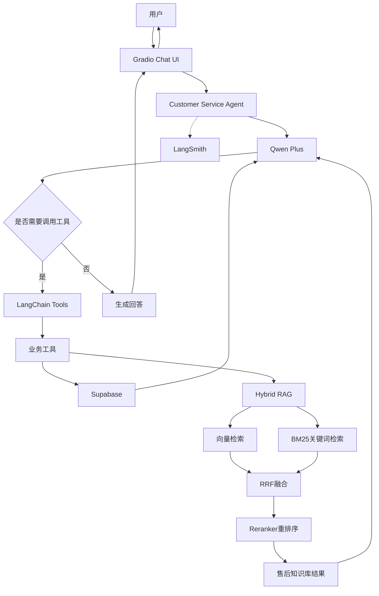

# 智能电商客服 Agent

基于大语言模型与 RAG 技术构建的智能电商客服 Agent，能够理解用户的自然语言问题，主动调用业务工具查询商品、订单和物流信息，并结合售后知识库回答退换货及售后政策问题。

项目采用 LangChain 构建 Agent 核心，结合混合检索与 Reranker 提升知识检索质量，并通过 Gradio 提供交互界面。

## 一、项目介绍

### 1. 项目目标

构建一个具备业务理解、工具调用、知识检索和多轮对话能力的电商智能客服系统，模拟真实电商平台的部分客服业务场景。

### 2. 核心功能

| 功能模块 | 功能说明 |
|---|---|
| 商品查询 | 根据商品名称查询价格、库存及商品信息 |
| 订单查询 | 查询订单状态、金额等信息 |
| 物流查询 | 查询订单物流单号及物流状态 |
| 退货资格检查 | 根据订单签收时间和退货规则判断是否符合退货条件 |
| 退款资格检查 | 综合订单状态、退款原因和退货期限判断退款资格 |
| 售后知识问答 | 基于 RAG 检索售后政策及相关知识 |
| 客服工单 | 根据用户问题创建客服工单 |
| 多轮对话 | 支持连续对话及独立会话 |
| 流式输出 | 实时展示 Agent 生成的回答 |

## 二、技术栈

| 技术 | 用途 |
|---|---|
| Python | 项目主要开发语言 |
| Qwen Plus | 大语言模型 |
| LangChain | Agent 构建、工具调用和消息管理 |
| LlamaIndex | RAG 文档处理与检索相关组件 |
| MinerU API | 文档解析 |
| Qwen Embedding | 文本向量化 |
| Zilliz Cloud | 向量数据库 |
| BM25 | 关键词检索 |
| RRF | 混合检索结果融合 |
| Qwen3 Reranker | 检索结果重排序 |
| Supabase | 关系型数据库及业务数据存储 |
| Gradio | Web 聊天交互界面 |
| LangSmith | Agent 执行链路追踪与调试 |
| Pytest | 自动化测试 |

## 三、系统架构



## 四、核心技术实现

### 1. Agent 工具调用

基于 LangChain 的工具调用能力构建单 Agent 系统。

主要实现方式：

- 使用 `bind_tools()` 将业务工具绑定到大语言模型。
- 由模型根据用户问题自主判断是否需要调用工具。
- 通过 Python 循环处理模型返回的工具调用请求。
- 执行工具并将结果通过 ToolMessage 返回给模型。
- 支持多轮工具调用，最终由模型组织自然语言回答。

同时对工具返回结果进行统一规范化处理，区分成功、未找到、未知和执行失败等状态，减少模型对异常结果的误判。

### 2. Hybrid RAG 混合检索

针对电商售后知识库，采用语义检索与关键词检索相结合的混合召回方案。

检索流程：

1. 使用 Embedding 模型将用户问题转换为向量。
2. 通过 Zilliz Cloud 进行向量相似度检索。
3. 使用 BM25 进行关键词检索。
4. 使用 RRF（Reciprocal Rank Fusion）融合两路召回结果。
5. 使用 Reranker 模型对候选文档重新排序。
6. 根据相关性阈值过滤低质量结果。
7. 将最终检索结果交给 Agent 生成回答。

该方案结合语义检索对自然语言表达的理解能力，以及关键词检索对商品名称、政策术语等精确词汇的匹配能力，提高知识召回的覆盖率和相关性。

### 3. 业务工具与服务层

将业务逻辑封装为独立 Service，并通过 LangChain Tool 暴露给 Agent。

主要工具包括：

- `query_product`：查询商品。
- `query_order`：查询订单。
- `query_logistics`：查询物流。
- `check_return_window_tool`：检查退货期限。
- `check_refund_eligibility`：检查退款资格。
- `search_after_sales_knowledge`：查询售后知识库。
- `create_support_ticket`：创建客服工单。

业务服务层负责数据查询、参数校验和业务规则判断，Agent 负责理解用户意图、选择工具及组织回答。

### 4. 安全与业务边界

- 对订单查询进行用户归属校验。
- 对退款资格进行业务规则检查。
- 将退款资格检查与实际退款提交区分开。
- 不允许 Agent 在缺乏知识依据时随意编造平台政策。
- 工具异常通过统一结果结构返回，避免直接暴露底层异常信息。

### 5. 可观测性

- 使用 Python logging 记录 Agent 运行过程、工具执行状态和耗时。
- 使用 RotatingFileHandler 实现日志文件轮转。
- 使用 LangSmith 追踪模型调用、工具调用及执行链路，辅助定位问题和分析 Agent 行为。

## 五、项目目录

```text
AICustomerService/
├── data/                       # 原始文档及知识库数据
├── logs/                       # 系统运行日志
├── src/
│   ├── agent/                  # Agent 核心及 Prompt
│   ├── core/                   # LLM、日志、安全及工具结果处理
│   ├── database/               # Supabase 数据库连接
│   ├── services/               # 商品、订单、退款、工单业务服务
│   ├── tools/                  # Agent 可调用的业务工具
│   ├── ui/                     # Gradio Web 聊天界面
│   └── rag/
│       ├── parsers/            # MinerU 文档解析
│       ├── ingestion/          # 文档处理及知识入库
│       ├── retrieval/          # 向量检索、BM25、混合检索及重排序
│       ├── embedding.py        # Embedding 模型
│       ├── vector_store.py     # 向量数据库
│       └── bm25_store.py       # BM25 索引
├── tests/                      # 自动化测试
├── .env                        # 环境变量（不提交）
├── .gitignore
├── pytest.ini
└── README.md
```

## 六、运行方式

### 1. 环境要求

- Python 3.12
- 可访问阿里云百炼、Supabase 和 Zilliz Cloud 的网络环境

### 2. 安装依赖

```bash
pip install -r requirements.txt
```

### 3. 配置环境变量

在项目根目录创建 `.env` 文件，配置以下参数：

```env
# Qwen
DASHSCOPE_API_KEY=your_api_key
DASHSCOPE_BASE_URL=https://dashscope.aliyuncs.com/compatible-mode/v1
QWEN_MODEL=qwen-plus

# Supabase
SUPABASE_URL=your_supabase_url
SUPABASE_KEY=your_supabase_key

# MinerU
MINERU_API_KEY=your_mineru_api_key

# Zilliz Cloud
ZILLIZ_CLOUD_URI=your_zilliz_uri
ZILLIZ_CLOUD_TOKEN=your_zilliz_token

# Reranker
RERANK_API_URL=your_rerank_api_url
RERANK_MODEL=qwen3-rerank
RERANK_SCORE_THRESHOLD=0.5
```

请根据实际配置补充其他必要环境变量。不要将真实密钥提交到 Git 仓库。

### 4. 启动项目

在项目根目录执行：

```bash
python -m src.ui.app
```

浏览器访问：

```text
http://127.0.0.1:7860
```

## 七、典型业务演示

### 场景一：商品查询

用户：

> AirPods Pro 2 多少钱？

Agent 调用商品查询工具，返回商品价格、库存和介绍。

### 场景二：订单查询

用户：

> 我的订单 ORD202611080001 目前是什么状态？

Agent 查询订单信息并返回订单状态。

### 场景三：售后政策问答

用户：

> 我的订单 ORD202611080001 还能退货吗？

Agent 结合订单查询、售后知识库检索和退货期限检查，综合判断并回答。

### 场景四：退款资格检查

用户：

> 商品出现质量问题，我想申请退款。

Agent 查询相关订单并检查退款资格，向用户说明检查结果。

注意：资格检查不等于实际退款提交。

### 场景五：人工客服工单

用户：

> 帮我联系人工客服。

Agent 根据用户问题创建客服工单，并告知工单当前处理状态。

## 八、项目特点

1. **自主工具调用**：由大语言模型根据用户意图选择合适的业务工具，而不是依赖固定关键词路由。
2. **混合 RAG 检索**：融合向量检索和 BM25 关键词检索，并通过 RRF 和 Reranker 提升检索质量。
3. **业务与 Agent 解耦**：业务规则放在 Service 层，工具层负责连接 Agent 与业务能力。
4. **可观测性**：通过日志与 LangSmith 追踪 Agent 执行过程。
5. **面向真实业务场景**：覆盖商品、订单、物流、售后和客服工单等典型电商客服流程。

## 九、项目说明

本项目为个人学习与求职作品，业务数据采用模拟数据，主要用于展示 Agent 开发、工具调用、RAG 检索和工程实践能力。